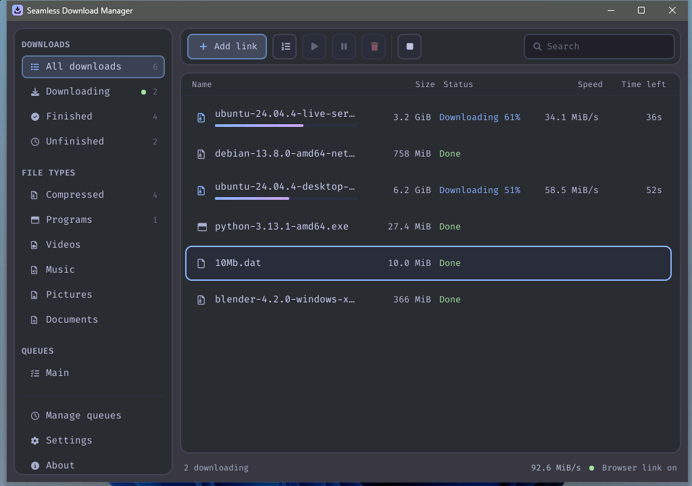

<div align="center">



# Seamless Download Manager

**A fast download manager for Windows, written in Rust, with its own browser extension.**

It also comes as a Windhawk mod, installed from [Seamless Workshop](https://github.com/DavidHiFi/seamless-workshop).

<a href="https://github.com/DavidHiFi/seamless-download-manager/releases/latest">

</a>

<br><br>


</div>

---

## Installation

1. Download `seamless-download-manager-setup-<version>.exe` from the [latest release](https://github.com/DavidHiFi/seamless-download-manager/releases/latest) and run it.
2. Pick what you want (start with Windows, Start menu, connect your browsers) and press **Install**. It installs for your account only, so it needs no admin rights.
3. Add the browser extension from the same release:
   - **Chromium browsers** (Chrome, Brave, Helium): unzip `extension-chromium.zip`, open the extensions page, turn on developer mode and choose **Load unpacked**.
   - **Zen and Firefox**: open `seamless-download-manager.xpi`. Stock Firefox only takes signed add-ons; Zen, Developer Edition and Nightly can turn that check off.

To update, run the newer installer. To remove it, use **Settings > Apps**, or run the installer again and press **Remove**. Your downloaded files always stay.

### As a Windhawk mod

The same engine will run inside [Windhawk](https://windhawk.net) as the **Seamless Download Manager** mod, with no separate app in the tray. Install it from [Seamless Workshop](https://github.com/DavidHiFi/seamless-workshop): open the Workshop, find Seamless Download Manager under Tools and press Install. The Workshop also sets up the engine it needs. The mod and the app share one download list and one browser link, and only one of them runs at a time.

## Features

### Downloads

- **Many connections per file:** splits a download into parts and resumes where it stopped.
- **Stream playlists:** saves HLS video streams as one file.
- **Queues:** run downloads one after another or a few at a time, on a schedule, with an optional sleep or shut down when a queue ends.
- **Speed limits:** for everything, or per download.
- **Add many:** turn a numbered link pattern like `photo-*.jpg` into a batch.
- **Per-site rules:** connections and speed limits for a site and its subdomains.
- **Sign-ins:** a name and password per download for sites that ask.
- **File check:** compare a finished file's MD5, SHA-1, SHA-256 or SHA-512 with the site's value.

### Browser

- **Own extension** for Chromium browsers and Firefox-based browsers.
- **Catches what others miss:** files sent by a form, files without an extension, and the same click sent twice.
- **Private link:** the app only takes downloads from the extension, which gets its key through the browser's own helper.

### Window

- **Catppuccin Mocha** look with frosted glass, in a window that stays usable down to phone width.
- **Tray icon**, start with Windows, and sounds when a download finishes or fails.
- **Command line:** add, list, pause, resume and remove downloads from a script.

## Notes

> [!NOTE]
> **New project.** Version 0.1 runs on its author's PC every day, but it has not been tested on many others yet. Bug reports help a lot.

> [!IMPORTANT]
> **The Zen and Firefox add-on is not signed yet.** Chromium browsers load it unpacked. Mozilla signing is planned.

<details>
<summary><b>Command line</b></summary>

<br>

Run these against `seamless-download-manager.exe` in `%LOCALAPPDATA%\SeamlessDownloadManager\bin`:

```text
download add --link <url> [--folder <dir>] [--name <file>] [--start]
             [--queue <name or id>] [--category <name or id>] [--header "Name: value"]...
list                 every download with its id
pause <id>           pause a download
resume <id>          resume a download
remove <id> [--delete-file]
show                 bring the window forward
gui exit             close the app
```

</details>

<details>
<summary><b>Building from source</b></summary>

<br>

Needs Rust 1.85 or newer on Windows (64-bit).

```powershell
cargo test --release --workspace
cargo build --release --workspace
# The installer packs the release programs, so build it after them:
$env:SDM_SETUP_REQUIRE_PAYLOAD = "1"; cargo build --release -p sdm-setup
# Browser extension (Pillow and resvg_py for the icons):
powershell -File extension\build.ps1
```

| Folder | What it is |
|---|---|
| `crates/sdm-engine` | Downloading: connections, parts, resume, streams |
| `crates/sdm-core` | Download list, queues, settings, storage |
| `crates/sdm-api` | The local, keyed link the extension talks to |
| `crates/sdm-ffi` | The engine as a library for the Windhawk mod ([commands](docs/engine-library.md)) |
| `app` | The window, tray and command line |
| `host` | The small browser helper |
| `setup` | The installer |
| `extension` | The browser extension, plain JavaScript |

</details>

## Contributing

Bug reports with steps and the link that failed (if you can share it), screenshots and pull requests all help.

<a href="CONTRIBUTING.md">

</a>

## Star history

Thank you for every star.

<a href="https://www.star-history.com/?repos=DavidHiFi%2Fseamless-download-manager&amp;type=date">
  <picture>
    <source media="(prefers-color-scheme: dark)" srcset="https://api.star-history.com/chart?repos=DavidHiFi/seamless-download-manager&amp;type=date&amp;theme=dark&amp;legend=top-left" />
    <source media="(prefers-color-scheme: light)" srcset="https://api.star-history.com/chart?repos=DavidHiFi/seamless-download-manager&amp;type=date" />
    
  </picture>
</a>

## Credits

- **Author:** Myself, [DavidHiFi](https://github.com/DavidHiFi)

| Who | What |
|---|---|
| **amir1376** ([AB Download Manager](https://github.com/amir1376/ab-download-manager)) | The app whose ideas this is built on: its features and the layout of its window. No code is copied. |
| **Catppuccin** ([palette](https://github.com/catppuccin/catppuccin)) | The Mocha colours. |
| **The Fira Code Project Authors** ([Fira Code](https://github.com/tonsky/FiraCode)) and **Nerd Fonts** ([nerd-fonts](https://github.com/ryanoasis/nerd-fonts)) | The font and icons, bundled under the SIL Open Font License (`app/assets/fonts/OFL.txt`). |

Built on [Rust](https://www.rust-lang.org), with [Slint](https://slint.dev), [Tokio](https://tokio.rs), [reqwest](https://github.com/seanmonstar/reqwest), [axum](https://github.com/tokio-rs/axum), [rusqlite](https://github.com/rusqlite/rusqlite), [windows-rs](https://github.com/microsoft/windows-rs) and [tray-icon](https://github.com/tauri-apps/tray-icon).

> Missing or wrong credit? [Open an issue](https://github.com/DavidHiFi/seamless-download-manager/issues/new) and I'll fix it.

## Disclaimers

Most of this project's code was developed with AI coding agents, including Claude Code, Codex and OpenCode. No single AI agent made the project.

The app talks to the internet only to download what you add, and, when you press **Check for updates**, to read this repo's latest release. It sends nothing else.

<div align="center">
<br>
<sub>Not affiliated with AB Download Manager or its authors.</sub>
</div>
